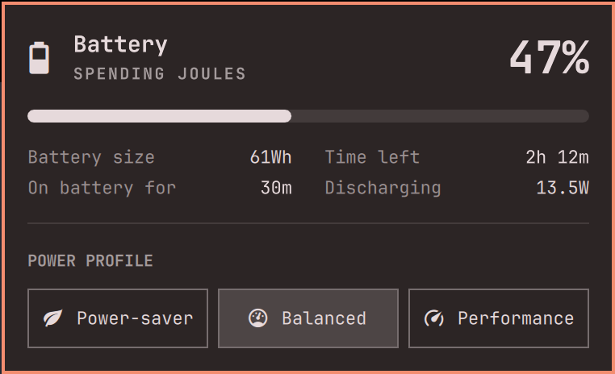

# OmaPower

[Omarchy](https://omarchy.org)'s Power panel with one change: instead of the
battery's charge cycles, it shows how long you've been **on battery** or
**plugged in**.



## What it shows

- **On battery for** while unplugged, **Plugged in for** while on the charger.
- Counted from the last time the charger was connected or disconnected, as
  `just now`, `25m`, `2h 5m` or `1d 3h`.
- Rebooting, hibernating or restarting the shell doesn't reset it.
- If the power source hasn't changed in the last 7 days, it shows `over 7d`.

Everything else is Omarchy's panel, unchanged.

## How it works

The time comes from UPower's charge history, which UPower keeps on disk and
serves over D-Bus. The panel asks for the last 7 days of it (`GetHistory` on
the battery device) and finds the most recent switch between charging and
discharging. Nothing runs in the background: the history is read only while
the panel is open, every 5 seconds, like the panel's other figures.

It needs `busctl` (part of systemd) and `jq`, both included in Omarchy.

## Install

```sh
omarchy plugin add https://github.com/lszl84/omapower.git --enable
```

OmaPower replaces the built-in Power widget in the bar, in the same place.

## Uninstall

```sh
omarchy plugin remove com.devmindscape.omapower
```

The built-in Power widget comes back.

## Based on

Omarchy 4.0.6's `omarchy.power` panel. The first commit in this repository is
that panel, unchanged, so `git diff` against it shows exactly what OmaPower
changes, and newer Omarchy releases can be compared with the same base.

## License

MIT. The original panel is by David Heinemeier Hansson (Omarchy); the changes
are by Lukasz Sromek. See [LICENSE](LICENSE).
